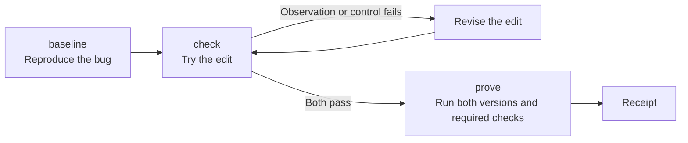

# VERB

**Verify Expected Runtime Behavior** checks whether a patch fixes a reported bug. Give it a known-broken Git revision, a small program that exercises the real application (a *probe*), and the observations you expect. VERB compares both versions and saves what each one did in a JSON receipt.

For example, suppose an empty display name should produce `Hello, !`, while a missing name should still produce `Hello, Guest!`. A patch that drops the fallback entirely fixes the first case. Checking the second case catches that mistake.



## Quick start

You need **Node.js 22+ and Git**. From a directory with room for two new folders, run the following in PowerShell or a POSIX shell. The first command downloads VERB. The rest of the demo runs offline.

```sh
git clone https://github.com/rzzli/VERB.git verb-tool
node verb-tool/examples/node/create-demo.mjs verb-demo
cd verb-demo
node ../verb-tool/bin/verb.js baseline claim.json --base HEAD
node patch.mjs wrong
node ../verb-tool/bin/verb.js check claim.json
```

The last command should print **FAILED** and exit **1**. Look for `MISS missing name [control]`. Now try the correct edit and run the project's required tests.

```sh
node patch.mjs fixed
node ../verb-tool/bin/verb.js prove claim.json --base HEAD
node ../verb-tool/bin/verb.js status --active
```

Both commands after the edit should print **VERIFIED**. The proof prints the receipt path. Run `summary` with that path to see the two observations and which required tests ran. [Demo claim](examples/node/claim.json) · [Probe](examples/node/probe.mjs)

## Use it in your project

Run VERB from the Git checkout you want to test. The simplest installation is a separate VERB checkout, as in the demo. To pin a project-local copy, run `npm pack` in the VERB checkout, copy the archive to your project's `vendor/` directory, and install that file from the project root. Use the filename printed by npm.

```sh
npm install --save-dev ./vendor/verb-runtime-verify-0.2.0.tgz
npm exec --offline -- verb --help
```

Commit the archive and dependency metadata together if others will install from that path. The CLI uses Node built-ins and Git. Your project's build and test commands may have their own prerequisites.

1. Copy the claim template. Use a frozen entry point such as `"probe": ["{node}", "{bundle}/probe.mjs"]` with `"fixtures": ["probe.mjs"]`. Put any helpers that interpret the result in the bundle too. A checkout-local observer can change with the patch even when the claim digest matches. [Claim template](templates/claim.json)
2. Call the real application and emit one UTF-8 JSON object. For the greeting example the shape is `{"origin":"…","observations":{"empty name":"Hello, !","missing name":"Hello, Guest!"}}`. Fill `origin` with the actual absolute path of the loaded application file. Declare the expected values, a neighboring case, and required project checks in the claim. [Probe contract](GUIDE.md#write-a-probe)
3. Run `baseline`, `check`, and `prove` from the target checkout. For a project-local installation, use `npm exec --offline -- verb …`. An existing coding agent can propose a probe and look for wrong edits that it would still accept. [Agent skill](skills/verb-regression/SKILL.md)

### Optional blind review

Ask your coding agent to **“use VERB blind review for this bug.”** Give a fresh reviewer the report, the broken revision, and the public contract. The reviewer designs a probe and a neighboring control. The coordinator freezes them against the broken revision before revealing the patch, then runs a fresh proof with the same inputs and the checkout's existing verification history. The review record identifies who designed the check and what they saw. [Blind review procedure](skills/verb-regression/references/blind-review.md)

## Commands

| Command | What it establishes |
| --- | --- |
| `verb baseline CLAIM --base REF` | The named revision shows the reported symptom. Saves the frozen claim and fixtures. |
| `verb check CLAIM` | Current edits satisfy the behavioral assertions against the saved baseline. Skips the required suite for quick feedback. |
| `verb prove CLAIM --base REF [--candidate REF]` | Freshly compares both versions and runs the candidate's required checks. Defaults to the working tree, including new source files. |
| `verb status [RECEIPT]` | Matches a historical proof to the current working files. Changes to an external claim are checked by `--active`. |
| `verb status --active` | Checks claims activated in this checkout. A fresh checkout with zero active claims exits successfully. |
| `verb summary RECEIPT` | Shows observed values, controls, and required-command outcomes. |
| `verb deactivate CLAIM` | Retires a finished claim. A path mismatch reports which claims are still active. |

In CI, fetch the broken revision, inspect the frozen observer, and run `verb prove CLAIM --base BASE_SHA --candidate HEAD`. A focused check after history rotation can make `status` accept an older, invalidated proof. [History and recovery](GUIDE.md#history-and-recovery)

**Verdict exit codes** are `0` for verified, `1` for failed, and `2` for inconclusive. An already-fixed baseline, missing observation, or timeout makes a proof inconclusive. Use `--json` for machine-readable verdicts. `summary` exits zero when it can display the receipt, including one for a failed proof.

## What works today

VERB targets trusted Git projects whose behavior can be exercised by a local command. The probe language is your choice. Commands run with your permissions in temporary source snapshots. Builds that need Git history require an application-supported source-archive mode. Windows and Linux have automated coverage. macOS and native Windows console interruption still need validation.

The automated pilot covered five historical fixes in two projects. The slowest of 30 focused checks took **1.338 seconds** on those checkouts. File count, asset size, setup, and required commands determine the cost on your own project. First-time human setup time remains unmeasured. [Pilot results and resource measurements](https://github.com/rzzli/VERB/blob/main/test/measurement/README.md)

[Configure a hook](GUIDE.md#wire-a-hook) · [Builds and dependencies](GUIDE.md#projects-that-need-a-build) · [Read a receipt](GUIDE.md#review-a-summary) · [Replay a Python regression](GUIDE.md#replay-the-click-regression)

## Tests

From the source checkout, run `npm test` for the regression suite and `npm run test:installed` to pack VERB, install it offline, and exercise the installed CLI and hooks.
