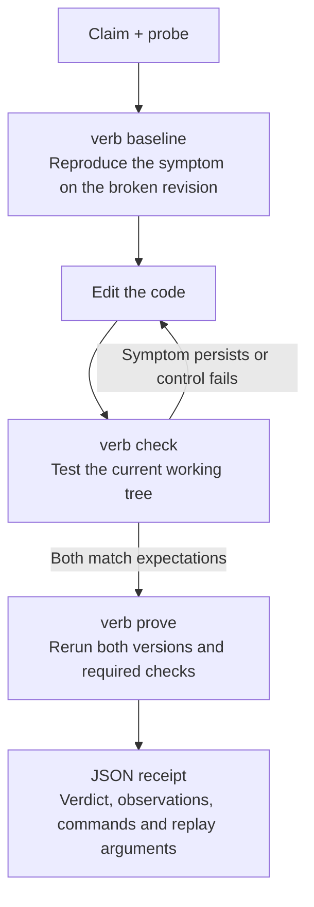

# VERB

**Did the patch fix the behavior the user reported?**

VERB runs the same probe on a known-broken revision and a proposed fix. It records what each version did, checks a neighboring case that should still work, and gives you a receipt you can inspect or replay. Use it on uncommitted edits or between two Git commits.

*Verify Expected Runtime Behavior*

[Quick start](#quick-start) · [Commands](#commands) · [Write a probe](#write-a-probe) · [Tests](#tests)

## How it works

A **claim** describes the symptom and expected fix. A **probe** drives the real CLI and reports what it observed. Freezing the probe and its fixtures lets you apply the same test before and after an edit.



## Quick start

Start with **Node.js 22+ and Git**. This complete example is offline: no Python, npm install, downloads, or global configuration changes. The initializer creates a **new disposable repository**, gives it a local Git identity, and commits its intentionally broken starting point. It refuses an existing destination.

The small Greeter CLI wrongly replaces an explicitly empty display name with `Guest`. A tempting broad patch removes the fallback entirely: that fixes the reported symptom but breaks the neighboring **missing-name** case. The probe runs the actual built entry point for empty, missing, and named inputs; it does not inspect source text or substitute its own greeting logic.

Run these commands from the VERB repository root. In an installed package, use its installation directory instead (it also contains the example and executable).

**PowerShell**

```powershell
$verb = (Resolve-Path bin/verb.js).Path
node examples/node/create-demo.mjs ../verb-node-demo
Set-Location ../verb-node-demo
node $verb baseline claim.json --base HEAD    # VERIFIED: reproduce the broken behavior
node patch.mjs wrong
node $verb check claim.json                   # FAILED: symptom passes, missing-name control fails
node patch.mjs fixed
node $verb check claim.json                   # VERIFIED: behavior only
node $verb prove claim.json --base HEAD       # VERIFIED: both versions and required tests
node $verb status --active                    # VERIFIED
```

<details>
<summary>POSIX shell commands</summary>

```sh
verb="$PWD/bin/verb.js"
node examples/node/create-demo.mjs ../verb-node-demo
cd ../verb-node-demo
node "$verb" baseline claim.json --base HEAD
node patch.mjs wrong
node "$verb" check claim.json                 # expected exit 1; continue with the correct patch
node patch.mjs fixed
node "$verb" check claim.json
node "$verb" prove claim.json --base HEAD
node "$verb" status --active
```

</details>

The tutorial patch selector changes only the Greeter source expression:

| Revision | Expression | Explicitly empty name | Missing name |
| --- | --- | --- | --- |
| Broken | `config.displayName \|\| 'Guest'` | `Hello, Guest!` | `Hello, Guest!` |
| Broad wrong patch | `config.displayName ?? ''` | `Hello, !` | `Hello, !` — control fails |
| Correct fix | `config.displayName ?? 'Guest'` | `Hello, !` | `Hello, Guest!` |

`setup` builds each snapshot; the frozen claim supplies the example project's supported `GREETER_BUILD_VERSION=demo-1` override. `prove` also runs the Greeter tests, including malformed-input checks. Read the observations and required-command result in the receipt; use `node "$verb" summary RECEIPT` with its printed receipt path for a short report. The initializer and patch selector are tutorial conveniences, not VERB commands. This deliberately small fixture demonstrates the workflow, not general real-project effectiveness.

[Complete claim](<examples/node/claim.json>) · [CLI source](<examples/node/greeter.cjs>) · [Probe](<examples/node/probe.mjs>) · [Build/version override](<examples/node/build.cjs>) · [Required tests](<examples/node/greeter.test.cjs>)

### Python interoperability: Click (optional, networked)

Return to the VERB repository root for this separate example. Replay a real bug in Click’s `--help` output. Both revisions exit successfully. Only the fix shows `[default: ""]` for an explicitly empty default while leaving an unset option unlabeled.

Start in the VERB repository root with **Node.js 22+, Git, and Python 3.11**. The example uses a local Python environment.

**PowerShell**

```powershell
$verb = (Resolve-Path bin/verb.js).Path
$claim = (Resolve-Path examples/click/claim.json).Path
git clone https://github.com/pallets/click.git click-demo
Set-Location click-demo
py -3.11 -m venv .venv
$env:VERB_PYTHON = (Resolve-Path .venv/Scripts/python.exe).Path
& $env:VERB_PYTHON -m pip install "pytest>=8,<9" colorama
node $verb prove $claim --base c021f05 --candidate d3e3852
```

<details>
<summary>Linux commands</summary>

```sh
verb="$PWD/bin/verb.js"
claim="$PWD/examples/click/claim.json"
git clone https://github.com/pallets/click.git click-demo
cd click-demo
python3.11 -m venv .venv
export VERB_PYTHON="$PWD/.venv/bin/python"
"$VERB_PYTHON" -m pip install 'pytest>=8,<9' colorama
node "$verb" prove "$claim" --base c021f05 --candidate d3e3852
```

</details>

**Expected result: `VERIFIED` (exit 0).** The receipt shows both option labels and the result of Click’s option test suite. A patch that labels *every* option fails the unset-option check. [Example claim](examples/click/claim.json) · [Probe](examples/click/probe.py)

## Commands

Run the installed `verb` command from the Git checkout you want to test. From a source checkout, use `node /absolute/path/to/VERB/bin/verb.js` with the same arguments instead; the core needs no npm dependency installation or global linking.

| Command | Use it to |
| --- | --- |
| `verb baseline CLAIM --base REF` | Confirm the broken revision exhibits the specified symptom and save the frozen inputs. |
| `verb check CLAIM` | Compare current edits against the saved baseline during development. |
| `verb prove CLAIM --base REF [--candidate REF]` | Run a fresh comparison and the candidate’s required checks. The candidate defaults to your working tree. |
| `verb status [RECEIPT]` | Return verified only if a working-tree `prove` receipt is verified, still matches the current files, and has not been invalidated by later completed contradictory evidence. With no argument, use the newest matching proof attempt, including attempts that stopped before the candidate ran. `check` and commit-only receipts do not count, and `status` records no execution of its own. |
| `verb status --active` | Hook mode: require a fresh proof for every active baseline, including the same frozen inputs and broken revision. With no active claims, succeed without hashing the checkout. |
| `verb deactivate CLAIM` | Remove the saved baseline for a finished or intentionally abandoned claim; leave receipts intact. |
| `verb summary RECEIPT` | Print a short report for a pull request: claim digest, both revision identities, observed values, controls, and required command outcomes. |

Add `--json` for machine-readable output. Exit codes distinguish **verified (0)**, **failed (1)**, and **inconclusive (2)**. For example, a candidate that still exhibits the bug fails. A baseline that never exhibited it makes the proof inconclusive. `status` returns 2 when it cannot confirm a fresh verified proof.

## What works today

The offline Node example is covered by the ordinary [onboarding regression](<test/onboarding.test.js>): it runs baseline/check/prove against the actual CLI, rejects the broad wrong patch, and checks required-test execution. The optional [Click release test](<test/click-gate.js>) exercises an upstream historical fix, an overbroad patch, and a probe loading the wrong checkout; it requires the separate Python/network setup above. Neither example establishes effectiveness across arbitrary projects.

VERB checks declared behavioral regressions, not arbitrary correctness, security, coverage, or behavior-preserving refactors. Local regressions have been exercised on Windows and native Linux processes under WSL2. **macOS is unverified. Native Windows console-control event delivery is also unverified**: the Windows cancellation test explicitly simulates the registered JavaScript signal handler, while POSIX tests send a real OS SIGINT. These limits are not claims of a broader hardware/CI support matrix.

## Use it with your coding agent

Give your agent the bundled skill and a bug report. Ask it to identify one plausible wrong fix and write a control that would catch it. Start with the complete offline Node example to see the protocol, or copy the template and replace its observations with values your CLI actually produces. [Agent skill](<skills/verb-regression/SKILL.md>) · [Claim template](<templates/claim.json>) · [Node example](<examples/node/claim.json>)

### Wire a hook

Replace `/absolute/path/to/VERB` with your local VERB checkout. Run the hook from the target Git repository. A successful `baseline` activates its claim; if a later baseline attempt fails, the claim stays active but needs a successful baseline again. Every new baseline needs a subsequent proof; a proof from a previous activation does not count. Proofs made by versions without this baseline binding must be rerun once. A failed attempt stays authoritative even when snapshot cleanup fails: VERB records the inconclusive attempt and its cleanup diagnostic, and both hooks block until a later successful proof. After the proof has served its purpose (for example, after committing), run `verb deactivate CLAIM` so future changes don't require proving the old bug again.

**Agent stop hook (Claude Code):** merge this into `.claude/settings.json`. Exit 2 asks the agent to keep working; the hook tells it what is missing.

```json
{
  "hooks": {
    "Stop": [{"hooks": [{"type": "command", "command": "node '/absolute/path/to/VERB/hooks/verify.mjs' --stop"}]}]
  }
}
```

**Git pre-commit:** put this in `.git/hooks/pre-commit` (or your configured hooks directory) and make it executable with `chmod +x`. With an active claim, stage all verified changes first: a working-tree proof does not approve a partial commit. The hook also rejects `assume-unchanged` and `skip-worktree` index flags, even on otherwise clean files, because they hide unstaged changes from Git. Clear them with `git update-index --no-assume-unchanged -- PATH` and `git update-index --no-skip-worktree -- PATH` before staging/proving. Sparse checkouts using these flags are not supported by this pre-commit gate. It also refuses Git content-filter attributes (including LFS): a clean filter can turn verified working bytes into different staged bytes while `git diff` is empty. Such repositories need a separate candidate-commit verification workflow rather than this working-tree pre-commit gate.

For the remaining cases, an empty normalized `git diff` is not treated as proof that staged bytes equal verified bytes. The hook materializes the staged tree with the *staged* attribute rules and compares its actual checkout bytes, file types, executable bits, and internal link targets with the working tree. The staged checkout must also match the content digest from the active proofs, and Git’s index tree must stay the same through the comparison. Line-ending (`text`/`eol`), `core.autocrlf`, `ident`, and `working-tree-encoding` conversions are therefore compared as Git would produce them: consistent repositories pass, and a converted difference is blocked before the commit exists. This comparison fails closed if the staged tree cannot be materialized, including tracked aliases into ignored shared directories declared with `link`; prove the commit directly in that case.

```sh
#!/bin/sh
exec node '/absolute/path/to/VERB/hooks/verify.mjs' --pre-commit
```

## Write a probe

Run the real CLI from the snapshot at `VERB_ROOT`. Use `VERB_PROFILE` for settings that need a fresh user directory. Emit one **UTF-8 JSON object** on stdout with the absolute path of the application file actually loaded and the values you observed. Legacy Windows code pages are not auto-detected: configure native shells to emit UTF-8. Command diagnostics are also decoded as UTF-8.

```json
{"origin":"/path/to/snapshot/src/app.js","observations":{"saved theme":"dark","unconfigured locale":"en"}}
```

Keep expected values in the claim. Return zero when the probe collected the observations, even on the broken version. List the probe and its input files under `fixtures` and rerun `verb baseline` when their bytes or executable bits change. POSIX executable fixture bits are preserved in both frozen copies. Use trusted probes and repositories, since commands run with your local permissions.

Use an explicit installed interpreter via `VERB_PYTHON` when using `{python}` on Windows; an operating-system app alias may launch an installer instead of Python. Claim environment overrides follow case-insensitive Windows names and case-sensitive POSIX names. VERB removes the inherited private `NODE_TEST_CONTEXT` recursion marker so an independent required `node --test` invocation cannot silently skip its test files. Other inherited variables, including `NODE_OPTIONS`, are not generally stripped; explicit claim `env` entries still take precedence, including an intentionally supplied `NODE_TEST_CONTEXT`.

Completed observations are compared with recent runs of the same side and frozen inputs. If they conflict, rerun with the same probe until the last three completed runs agree. A conflicting required command must likewise agree across its last three **actual completed executions**: `check`, commands skipped after an earlier failure, and timeouts cannot clear that conflict. Cached baselines don't count as reruns. A completed contradiction is sticky: it invalidates an older proof, so `status` blocks until three actual agreeing executions recover, and `check` can never turn an invalidated proof green. Recovery needs a later `prove`; `check` only supplies observation history. History appends are serialized per claim with a short lock, and a lock left by a killed writer fails closed with a retry message rather than being silently removed. Each claim retains up to 30 receipts and 30 sequenced history records. Within the receipt limit VERB reserves space for the active baseline and latest working proof attempt, including a failed or inconclusive attempt. Agreeing focused checks preserve the proof and its frozen baseline archive. History for older input identities eventually rotates out; export a summary before older receipts do.

### Projects that need a build

**Snapshots run as source archives.** Setup, probes, and required commands discard inherited Git repository routing and stop Git discovery before it reaches the enclosing checkout. The outer pre-commit hook continues to use the index selected by Git. A build that runs `git describe`, `git rev-parse`, or another repository query may work in the real checkout but fail during VERB setup. Treat that as unsupported until you can configure a genuine application-supported source-archive/version override. Never copy or link the original `.git` into the snapshots: it describes the original checkout and can make both sides consult the wrong revision or modify shared state.

The Node example demonstrates a tested, project-specific option rather than assuming a universal build variable. Its [build script](<examples/node/build.cjs>) normally derives a version from Git. Without an override it reports `Git metadata is unavailable` in a source-only snapshot; its supported `GREETER_BUILD_VERSION` option bypasses the Git query. The [claim](<examples/node/claim.json>) freezes the same value for both sides:

```json
{
  "env": { "GREETER_BUILD_VERSION": "demo-1" },
  "setup": [["{node}", "build.cjs"]],
  "required": [["{node}", "--test", "greeter.test.cjs"]]
}
```

`GREETER_BUILD_VERSION` belongs **only to this demo project's build contract**, not to VERB or other Node/Python toolchains. For a real project, find and test its own documented override, freeze the appropriate value in the claim, and disclose that version derivation itself was not tested. If the build genuinely needs Git history and offers no safe override, report the setup as inconclusive rather than presenting unrelated checks as a verified proof.

Install dependencies once in the real checkout and ensure the directory is Git-ignored. For example, in a TypeScript project with `/node_modules/` ignored, run `npm ci` there. Add these fields to the claim (keeping its probe, fixtures, and assertions):

```json
{
  "link": ["node_modules"],
  "setup": [["{node}", "node_modules/typescript/bin/tsc", "-p", "tsconfig.json"]],
  "required": [["{node}", "--test"]],
  "timeoutMs": 60000,
  "requiredTimeoutMs": 300000
}
```

Point the probe at the built CLI in its snapshot and report the built entry point as its origin. `setup` runs separately in each snapshot before the probe, so each side builds from its own source. Historical checkouts use their own Git attributes rather than the candidate's attribute files. `timeoutMs` applies to each setup/probe command; `requiredTimeoutMs` overrides it per required command. Interruption, timeout, and output overflow share command-stop teardown: VERB closes captured pipes and attempts process-tree termination. Interruption prevents later setup/probe/required phases and remains inconclusive. Killing escaped/detached descendants is best-effort, and process cleanup can add bounded overhead; this is not sandbox containment or a hard real-time deadline.

Commands are argv arrays, not shell snippets. On Windows, batch files cannot be launched directly by Node's non-shell spawn. Prefer the JavaScript CLI via `{node}` as above, or explicitly opt into the shell with a trusted command such as `["cmd.exe", "/d", "/s", "/c", "npm test"]`. For exactly this switch order and one final command-text argument (case-insensitive; bare or explicit cmd path), VERB applies cmd-specific quoting, including quoted batch paths and arguments. Other argv arrays retain Node's ordinary argument encoding; no shell is enabled implicitly. Launch errors are inconclusive and are recorded with no exit code.

Linked directories are **shared**, not copied or included in the working-tree digest. Don't write to them during verification or change their contents between sides. Do not share workspace dependencies whose symlinks/junctions load tracked source from the real checkout: that would make the baseline run candidate source. Install or build those dependencies separately in each snapshot instead. Build outputs should be generated in the snapshots, not shared. Symlinks whose targets exist inside the snapshot or a declared shared directory are preserved on hosts that support creating them. Absolute links into the original checkout are rewritten to relative links in the snapshot. Undeclared escaping links, dangling links, and Git submodules are rejected.

### Review a summary

`verb summary RECEIPT` reports both revision identities, each observation, and each required command's exit code (or `not run`/`unavailable`). Claim paths, origins, and fully qualified path arguments, including `--option=PATH`, are repository-relative using the receipt's Windows or POSIX path conventions, even on another OS. Observations and embedded scripts remain literal text; context-dependent path spellings are outside this formatting guarantee. Inspect the output for private data before sharing.

The digest covers the **raw claim bytes, all named fixture bytes, and each fixture's executable bits**, not just the claim file. Baselines created before executable-mode binding must be rerun once. To recompute it for the claim/probe you are reviewing, run this from the VERB checkout and compare with the summary:

```sh
node --input-type=module -e "import { freeze } from './lib/files.js'; console.log(freeze(process.argv[1]).digest)" "/path/to/claim.json"
```

A successful baseline also archives the exact bytes captured while freezing: the claim file unmodified (including compact/pretty formatting, BOM, and line endings) beside `fixtures/`. To reproduce a digest from archived evidence alone, copy the archived claim and fixtures into a normal claim/directory layout and run `freeze` on that claim path. Rewriting the archived claim as freshly serialized JSON changes the raw-byte digest even when the parsed object is identical.

Use the same file bytes (including line endings) and executable bits. Windows does not provide POSIX executable semantics, so moving fixtures across filesystems may change their digest. Source read/write permissions and ACLs are not fixture identity. A matching digest binds the claim and fixtures, not shared dependencies or a trusted attestation; VERB is not a sandbox or signed-receipt system.

### Claim scope and state

Every receipt reports the declared scope: number of observations, how many are unchanged controls, and how many required commands. A claim with no control or no required command is still valid, but VERB prints a `Scope:` warning instead of implying that either was exercised. Invalid claims name the exact field, for example `assertions[1].expected: unknown assertion field`, and unknown top-level keys are rejected rather than silently ignored.

Receipts and saved baselines now carry `verb-receipt/1` and `verb-baseline/1` format ids. Legacy records without a format id remain readable, but malformed, partial, or newer-format records fail closed with the record path instead of being skipped — skipping a damaged newest record could otherwise expose an older green proof. The approval rule lives in `proofProblem`/`currentConflict` in [store.js](<lib/store.js>) and is re-evaluated after slow cleanup by `finalize` in [verb.js](<bin/verb.js>); `status` only reads that rule and never appends history.

### Resource budgets

Snapshots hash, and for `prove` copy, the working tree once per side; that content volume — not the ~70 KB installed package — is the real cost driver. `npm run bench:resources` measures a small CLI, a 2,000-file tree, a 12 MiB tracked asset, and verbose output retention, reporting wall time, peak CLI RSS, content bytes, and retained `.git/verb` bytes. On one Windows host (Node 22.23.5, Git 2.53.0) the recorded runs were: 7-byte tree, `prove` 443 ms / 40.8 MiB RSS; 2,001 files, `prove` 6.1 s / 50.5 MiB; one 12 MiB binary asset, `prove` 997 ms / 57.5 MiB. Re-measure on your own filesystems before setting agent timeouts; file count and total bytes, plus antivirus/filesystem behaviour, dominate.

Retained state is bounded to 30 receipts and 30 history records per claim path, but a receipt retains capped command output (up to 4 MiB per command), so verbose required commands are the largest storage risk: a command printing 64 KiB per run produced 69,825-byte receipts (700,771 bytes over 11 runs). Deactivate the claim when it is finished. Replacing or deactivating a baseline releases its reserved evidence for normal rotation.

## Tests

Run `npm test` from the VERB repository; the offline Node workflow is included and needs only Node and Git. Run just that regression with `node --test test/onboarding.test.js`. To run the optional Click release test, complete the Python interoperability setup above and run `node ../test/click-gate.js` from `click-demo`. It exercises both revisions in a disposable clone.
