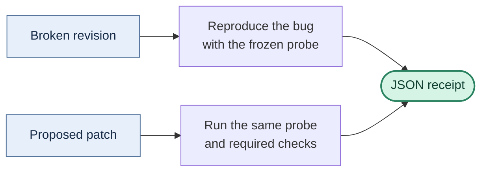

# VERB

**Verify Expected Runtime Behavior** is a local CLI for checking AI-assisted bug fixes. It runs the same small program (a *probe*) against the broken revision and your patch. The receipt shows what the application actually returned and which project checks ran.

**[Try the offline demo →](GUIDE.md#quick-start)** · [Use VERB in your project](GUIDE.md#use-it-in-your-project) · [Command reference](GUIDE.md#commands)



## A fix that looks right

A greeting CLI should preserve an explicitly empty name. A plausible patch removes the `Guest` fallback. Try two inputs and the mistake shows up.

| Input | Expected greeting | What the patch printed |
| --- | --- | --- |
| `{"displayName": ""}` | `Hello, !` | ✓ `Hello, !` |
| `{}` (name omitted) | `Hello, Guest!` | ✗ `Hello, !` |

**VERB returns `failed`.** The omitted-name case is a *control*. Its receipt explains the shortcut it caught. A duplicate helper could pass both checks, so use static analysis and code review for that question.

With the broken revision at `HEAD`, run `verb prove claim.json --base HEAD --strict` to test your edits. Strict mode requires an explained control and a project check. Teams can require this proof before merging selected fixes. [CI setup](GUIDE.md#require-a-proof-in-ci)

Your coding agent can suggest inputs. Replay is local and model-free with Node.js 22+, Git, and the project’s own prerequisites.

In a six-patch Click replay, VERB and the existing test suite caught the same three of four deliberately wrong fixes. [Pilot results](https://github.com/rzzli/VERB/blob/main/test/measurement/README.md#paired-click-pilot)

## Project structure

```text
bin/        CLI entry point
lib/        Git snapshots, probe execution, verdicts and receipts
templates/  Starter claim describing the bug and expected observations
examples/   Runnable Node and Python (Click) examples
skills/     Coding-agent instructions for designing and reviewing checks
hooks/      Optional Git pre-commit and agent stop checks
test/       Regression tests, verification pilots and measurements
docs/       Project audits and review notes
```
