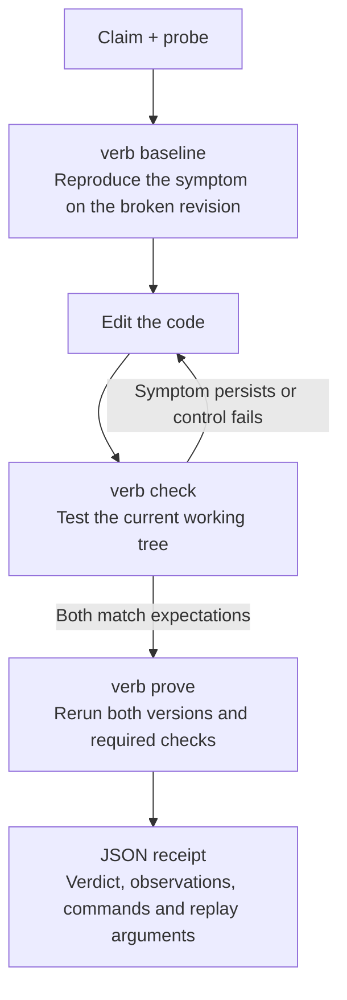

# VERB

**Did the patch fix the behavior the user reported?**

VERB runs the same probe on a known-broken revision and a proposed fix. It records what each version did, checks a neighboring case that should still work, and gives you a receipt you can inspect or replay. Use it on uncommitted edits or between two Git commits.

*Verify Expected Runtime Behavior*

[Quick start](#quick-start) · [Commands](#commands) · [Write a probe](#write-a-probe) · [Tests](#tests)

## How it works

A **claim** describes the symptom and expected fix. A **probe** drives the real CLI and reports what it observed. Freezing the probe and its fixtures lets you apply the same test before and after an edit.



## Quick start

Replay a real bug in Click’s `--help` output. Both revisions exit successfully. Only the fix shows `[default: ""]` for an explicitly empty default while leaving an unset option unlabeled.

Start in the VERB repository root with **Node.js 22+, Git, and Python 3.11**. The example uses a local Python environment.

**PowerShell**

```powershell
$verb = (Resolve-Path bin/verb.js).Path
$claim = (Resolve-Path examples/click/claim.json).Path
git clone https://github.com/pallets/click.git click-demo
Set-Location click-demo
py -3.11 -m venv .venv
$env:VERB_PYTHON = (Resolve-Path .venv/Scripts/python.exe).Path
& $env:VERB_PYTHON -m pip install "pytest>=8,<9" colorama
node $verb prove $claim --base c021f05 --candidate d3e3852
```

<details>
<summary>Linux commands</summary>

```sh
verb="$PWD/bin/verb.js"
claim="$PWD/examples/click/claim.json"
git clone https://github.com/pallets/click.git click-demo
cd click-demo
python3.11 -m venv .venv
export VERB_PYTHON="$PWD/.venv/bin/python"
"$VERB_PYTHON" -m pip install 'pytest>=8,<9' colorama
node "$verb" prove "$claim" --base c021f05 --candidate d3e3852
```

</details>

**Expected result: `VERIFIED` (exit 0).** The receipt shows both option labels and the result of Click’s option test suite. A patch that labels *every* option fails the unset-option check. [Example claim](examples/click/claim.json) · [Probe](examples/click/probe.py)

## Commands

Run `npm link` from the VERB repository to install the `verb` command. Then run it from the Git checkout you want to test.

| Command | Use it to |
| --- | --- |
| `verb baseline CLAIM --base REF` | Confirm the broken revision exhibits the specified symptom and save the frozen inputs. |
| `verb check CLAIM` | Compare current edits against the saved baseline during development. |
| `verb prove CLAIM --base REF [--candidate REF]` | Run a fresh comparison and the candidate’s required checks. The candidate defaults to your working tree. |
| `verb status [RECEIPT]` | Return verified only if a working-tree `prove` receipt is verified and still matches the current files. With no argument, use the newest matching proof attempt, including attempts that stopped before the candidate ran. `check` and commit-only receipts do not count. |
| `verb status --active` | Hook mode: require a fresh proof for every active baseline, including the same frozen inputs and broken revision. With no active claims, succeed without hashing the checkout. |
| `verb deactivate CLAIM` | Remove the saved baseline for a finished or intentionally abandoned claim; leave receipts intact. |
| `verb summary RECEIPT` | Print a short report for a pull request: claim digest, both revision identities, observed values, controls, and required command outcomes. |

Add `--json` for machine-readable output. Exit codes distinguish **verified (0)**, **failed (1)**, and **inconclusive (2)**. For example, a candidate that still exhibits the bug fails. A baseline that never exhibited it makes the proof inconclusive. `status` returns 2 when it cannot confirm a fresh verified proof.

## What works today

The reproducible example is the Click fix above. Its release test checks that VERB accepts the upstream fix, catches an overbroad fix, and identifies a probe that loads Click from outside the checkout. This is a historical replay. [Click release test](test/click-gate.js)

A separate [prospective pilot](docs/agent-pilot.md) recorded five new self-hosted VERB fixes with frozen baselines, first patches, pre-execution independent agent reviews, and receipts. All five first patches verified; no additional review-missed defect was observed. This is one-repository evidence, not proof of improved outcomes across projects. The [archived evidence and replay instructions](test/agent-pilot/README.md) are development-only and excluded from the package.

## Use it with your coding agent

Give your agent the bundled skill and a bug report. Ask it to identify one plausible wrong fix and write a control that would catch it. For a first claim, copy the template and replace its observations with values your CLI actually produces. [Agent skill](skills/verb-regression/SKILL.md) · [Claim template](templates/claim.json)

### Wire a hook

Replace `/absolute/path/to/VERB` with your local VERB checkout. Run the hook from the target Git repository. A successful `baseline` activates its claim; if a later baseline attempt fails, the claim stays active but needs a successful baseline again. Every new baseline needs a subsequent proof; a proof from a previous activation does not count. Proofs made by versions without this baseline binding must be rerun once. After the proof has served its purpose (for example, after committing), run `verb deactivate CLAIM` so future changes don't require proving the old bug again.

**Agent stop hook (Claude Code):** merge this into `.claude/settings.json`. Exit 2 asks the agent to keep working; the hook tells it what is missing.

```json
{
  "hooks": {
    "Stop": [{"hooks": [{"type": "command", "command": "node '/absolute/path/to/VERB/hooks/verify.mjs' --stop"}]}]
  }
}
```

**Git pre-commit:** put this in `.git/hooks/pre-commit` (or your configured hooks directory) and make it executable with `chmod +x`. With an active claim, stage all verified changes first: a working-tree proof does not approve a partial commit. The hook also rejects `assume-unchanged` and `skip-worktree` index flags, even on otherwise clean files, because they hide unstaged changes from Git. Clear them with `git update-index --no-assume-unchanged -- PATH` and `git update-index --no-skip-worktree -- PATH` before staging/proving. Sparse checkouts using these flags are not supported by this pre-commit gate. It also refuses Git content-filter attributes (including LFS): a clean filter can turn verified working bytes into different staged bytes while `git diff` is empty. Such repositories need a separate candidate-commit verification workflow rather than this working-tree pre-commit gate.

```sh
#!/bin/sh
exec node '/absolute/path/to/VERB/hooks/verify.mjs' --pre-commit
```

## Write a probe

Run the real CLI from the snapshot at `VERB_ROOT`. Use `VERB_PROFILE` for settings that need a fresh user directory. Emit one **UTF-8 JSON object** on stdout with the absolute path of the application file actually loaded and the values you observed. Legacy Windows code pages are not auto-detected: configure native shells to emit UTF-8. Command diagnostics are also decoded as UTF-8.

```json
{"origin":"/path/to/snapshot/src/app.js","observations":{"saved theme":"dark","unconfigured locale":"en"}}
```

Keep expected values in the claim. Return zero when the probe collected the observations, even on the broken version. List the probe and its input files under `fixtures` and rerun `verb baseline` when their bytes or executable bits change. POSIX executable fixture bits are preserved in both frozen copies. Use trusted probes and repositories, since commands run with your local permissions.

Use an explicit installed interpreter via `VERB_PYTHON` when using `{python}` on Windows; an operating-system app alias may launch an installer instead of Python. Claim environment overrides follow case-insensitive Windows names and case-sensitive POSIX names.

Completed observations are compared with recent runs of the same side and frozen inputs. If they conflict, rerun with the same probe until the last three completed runs agree. A conflicting required command must likewise agree across its last three **actual completed executions**: `check`, commands skipped after an earlier failure, and timeouts cannot clear that conflict. Cached baselines don't count as reruns. VERB retains the latest 30 receipts and 30 history records per claim path, carrying bounded required-command recovery history forward for the same input even through check-only runs. History for older input identities eventually rotates out; export a summary before older receipts do.

### Projects that need a build

Install dependencies once in the real checkout and ensure the directory is Git-ignored. For example, in a TypeScript project with `/node_modules/` ignored, run `npm ci` there. Add these fields to the claim (keeping its probe, fixtures, and assertions):

```json
{
  "link": ["node_modules"],
  "setup": [["{node}", "node_modules/typescript/bin/tsc", "-p", "tsconfig.json"]],
  "required": [["{node}", "--test"]],
  "timeoutMs": 60000,
  "requiredTimeoutMs": 300000
}
```

Point the probe at the built CLI in `dist/` and report the built entry point as its origin. `setup` runs separately in each snapshot before the probe, so each side builds from its own source. Historical checkouts use their own Git attributes rather than the candidate's attribute files. `timeoutMs` applies to each setup/probe command; `requiredTimeoutMs` overrides it per required command. On timeout or output overflow, VERB stops draining captured pipes after its termination attempt. Killing escaped/detached descendants is best-effort, and process cleanup can add bounded overhead; this is not sandbox containment or a hard real-time deadline.

Commands are argv arrays, not shell snippets. On Windows, `.cmd`/`.bat` files such as `npm.cmd` cannot be launched directly by Node's non-shell spawn. Prefer the JavaScript CLI via `{node}` as above, or explicitly opt into the shell with a trusted command such as `["cmd.exe", "/d", "/s", "/c", "npm test"]`. Launch errors are inconclusive and are recorded with no exit code; VERB does not silently enable shell parsing.

Linked directories are **shared**, not copied or included in the working-tree digest. Don't write to them during verification or change their contents between sides. Do not share workspace dependencies whose symlinks/junctions load tracked source from the real checkout: that would make the baseline run candidate source. Install or build those dependencies separately in each snapshot instead. Build outputs should be generated in the snapshots, not shared. Symlinks whose targets exist inside the snapshot or a declared shared directory are preserved on hosts that support creating them. Absolute links into the original checkout are rewritten to relative links in the snapshot. Undeclared escaping links, dangling links, and Git submodules are rejected.

### Review a summary

`verb summary RECEIPT` reports both revision identities, each observation, and each required command's exit code (or `not run`/`unavailable`). Claim paths, origins, and fully qualified path arguments, including `--option=PATH`, are repository-relative using the receipt's Windows or POSIX path conventions, even on another OS. Observations and embedded scripts remain literal text; context-dependent path spellings are outside this formatting guarantee. Inspect the output for private data before sharing.

The digest covers the **raw claim bytes, all named fixture bytes, and each fixture's executable bits**, not just the claim file. Baselines created before executable-mode binding must be rerun once. To recompute it for the claim/probe you are reviewing, run this from the VERB checkout and compare with the summary:

```sh
node --input-type=module -e "import { freeze } from './lib/files.js'; console.log(freeze(process.argv[1]).digest)" "/path/to/claim.json"
```

Use the same file bytes (including line endings) and executable bits. Windows does not provide POSIX executable semantics, so moving fixtures across filesystems may change their digest. Source read/write permissions and ACLs are not fixture identity. A matching digest binds the claim and fixtures, not shared dependencies or a trusted attestation; VERB is not a sandbox or signed-receipt system.

## Tests

Run `npm test` from the VERB repository. To run the Click release test, complete the quick start and run `node ../test/click-gate.js` from `click-demo`. It exercises both revisions in a disposable clone.
