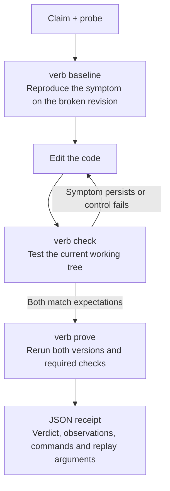

# VERB

**Did the patch fix the behavior the user reported?**

VERB runs the same probe on a known-broken revision and a proposed fix. It records what each version did, checks a neighboring case that should still work, and gives you a receipt you can inspect or replay. Use it on uncommitted edits or between two Git commits.

*Verify Expected Runtime Behavior*

[Quick start](#quick-start) · [Commands](#commands) · [Write a probe](#write-a-probe) · [Tests](#tests)

## How it works

A **claim** describes the symptom and expected fix. A **probe** drives the real CLI and reports what it observed. Freezing the probe and its fixtures lets you apply the same test before and after an edit.



## Quick start

Replay a real bug in Click’s `--help` output. Both revisions exit successfully. Only the fix shows `[default: ""]` for an explicitly empty default while leaving an unset option unlabeled.

Start in the VERB repository root with **Node.js 22+, Git, and Python 3.11**. The example uses a local Python environment.

**PowerShell**

```powershell
$verb = (Resolve-Path bin/verb.js).Path
$claim = (Resolve-Path examples/click/claim.json).Path
git clone https://github.com/pallets/click.git click-demo
Set-Location click-demo
py -3.11 -m venv .venv
$env:VERB_PYTHON = (Resolve-Path .venv/Scripts/python.exe).Path
& $env:VERB_PYTHON -m pip install "pytest>=8,<9" colorama
node $verb prove $claim --base c021f05 --candidate d3e3852
```

<details>
<summary>Linux commands</summary>

```sh
verb="$PWD/bin/verb.js"
claim="$PWD/examples/click/claim.json"
git clone https://github.com/pallets/click.git click-demo
cd click-demo
python3.11 -m venv .venv
export VERB_PYTHON="$PWD/.venv/bin/python"
"$VERB_PYTHON" -m pip install 'pytest>=8,<9' colorama
node "$verb" prove "$claim" --base c021f05 --candidate d3e3852
```

</details>

**Expected result: `VERIFIED` (exit 0).** The receipt shows both option labels and the result of Click’s option test suite. A patch that labels *every* option fails the unset-option check. [Example claim](examples/click/claim.json) · [Probe](examples/click/probe.py)

## Commands

Run `npm link` from the VERB repository to install the `verb` command. Then run it from the Git checkout you want to test.

| Command | Use it to |
| --- | --- |
| `verb baseline CLAIM --base REF` | Confirm the broken revision exhibits the specified symptom and save the frozen inputs. |
| `verb check CLAIM` | Compare current edits against the saved baseline during development. |
| `verb prove CLAIM --base REF [--candidate REF]` | Run a fresh comparison and the candidate’s required checks. The candidate defaults to your working tree. |
| `verb status RECEIPT` | Check whether the current working files still match a saved receipt. |

Add `--json` for machine-readable output. Exit codes distinguish **verified (0)**, **failed (1)**, and **inconclusive (2)**. For example, a candidate that still exhibits the bug fails. A baseline that never exhibited it makes the proof inconclusive.

## What works today

On Windows and Linux, VERB replayed five historical fixes across two repositories. The Click release test checks that VERB accepts the upstream fix, catches an overbroad fix, and identifies a probe that loads Click from outside the checkout. [Click release test](test/click-gate.js)

## Use it with your coding agent

Give your agent the bundled skill and a bug report. Ask it to identify one plausible wrong fix and write a control that would catch it. For a first claim, copy the template and replace its observations with values your CLI actually produces. [Agent skill](skills/verb-regression/SKILL.md) · [Claim template](templates/claim.json)

## Write a probe

Run the real CLI from the snapshot at `VERB_ROOT`. Use `VERB_PROFILE` for settings that need a fresh user directory. Emit one JSON object on stdout with the absolute path of the application file actually loaded and the values you observed.

```json
{"origin":"/path/to/snapshot/src/app.js","observations":{"saved theme":"dark","unconfigured locale":"en"}}
```

Keep expected values in the claim. Return zero when the probe collected the observations, even on the broken version. List the probe and its input files under `fixtures` and rerun `verb baseline` when any of them change. Use trusted probes and repositories, since commands run with your local permissions.

## Tests

Run `npm test` from the VERB repository. To run the Click release test, complete the quick start and run `node ../test/click-gate.js` from `click-demo`. It exercises both revisions in a disposable clone.
